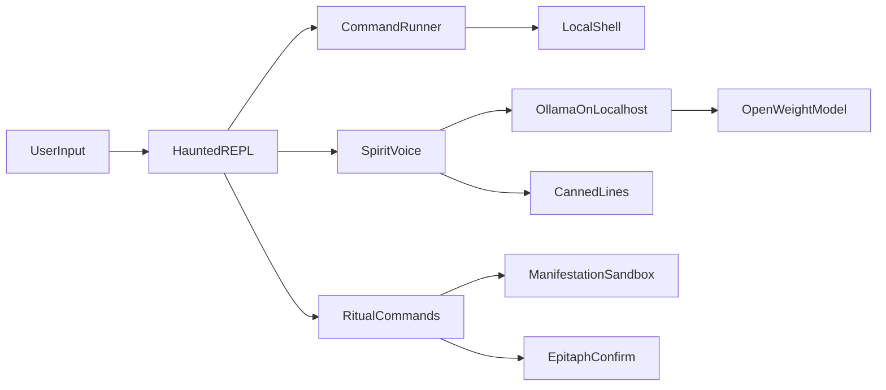

# Haunted Terminal

A Python terminal that feels possessed. You type real commands. A local open-weight model, served by Ollama on your own machine, comments in character, changes the prompt, invents ghost files, and drafts commit messages. Nothing in the model path leaves `127.0.0.1`.

The spirit can role-play three personalities. The Poltergeist rattles the pipes when something fails. The Archivist keeps a candle for finished work, in the spirit of Día de los Muertos. The Keeper watches the prompt like a lighthouse lamp.



## What stays on this machine

- Shell commands run locally. The model never receives a shell, and its text is never executed.
- The model sees the command you typed, the exit code, the directory name, and a few recent commands. It does not see command output, so a secret printed by a program is not copied into the prompt.
- Ghost files are written only under `.haunt/manifestations/`. `/banish` deletes only that folder. `.haunt/.gitignore` ignores the whole directory so a ghost file is not committed by accident.
- `/epitaph` drafts a commit message and runs `git commit` only after you type `y`. It will not push, amend, or force anything.
- If Ollama is asleep, or a reply takes longer than the timeout, the spirit speaks a canned line and the panel says "from memory". The shell keeps going.
- The only step that needs a network is the one-time `ollama pull`. After the weights are on disk, inference works with the network off.

Ollama's default context window is 2048 tokens and it drops the rest without an error. Every request here sets `num_ctx` to 4096 and sends a short prompt on purpose.

## Setup

Python 3.11 or newer, and [Ollama](https://ollama.com/).

```bash
pip install -e ".[dev]"
ollama pull gemma3:1b
haunt
```

`gemma3:1b` is the default because it is an open-weight Gemma model that runs on CPU. Override it with `--model` or `HAUNT_MODEL` if you already pulled another tag, such as `gemma3:270m` or `gemma3:latest`. `HAUNT_TIMEOUT` (default 8 seconds) is how long a whisper may take before the canned line is used. `OLLAMA_HOST` defaults to `http://127.0.0.1:11434` and is rejected unless it is loopback.

The first launch warms the model so the next whisper is not paying load time. Pulling the model is the slow part. Waking it is a few seconds on a CPU.

## Rituals

Ordinary lines are shell commands. `cd` and `pwd` are remembered by the session, because each other command starts a fresh shell. A line that starts with `/` is a ritual and is not passed to the operating system. Prefix a real command with `//` if you need a leading slash.

- `/spirit archivist` changes who is possessing the prompt
- `/spirits` lists them
- `/manifest` asks for one ghost file inside `.haunt/manifestations/`
- `/banish` removes those files
- `/epitaph` drafts a message for whatever you have staged, then commits only if you answer `y`
- `/quiet` and `/loud` turn commentary off and on
- `/exit`, `exit`, or Ctrl-D ends the session

Commentary is not on every keystroke. A non-zero exit always gets a whisper, and so do `git`, `rm`, and `kill`. Other successful commands are commented every second turn. The prompt's mood word is cached and refreshed every few commands.

A new spirit is a TOML file in `spirits/`. The code does not need to change.

## Demo and tests

```bash
haunt --demo
python -m pytest
```

`haunt --demo` writes `demo/session.txt` from the canned voice, in a temporary git repository, so the transcript is reproducible with the network off. It also tries one live comment and writes `demo/live-whisper.txt`. If Ollama or the model is missing, that file says so instead of pretending.

## Project layout

```text
src/haunted_terminal/   REPL, command runner, Ollama client, rituals
spirits/                poltergeist, archivist, and keeper personas
tests/                  no network; the HTTP client is a fake
demo/                   recorded session
```

`voice.py` is the only module that knows the Ollama URL. Tests replace it with the canned voice, or with a fake HTTP handler.
